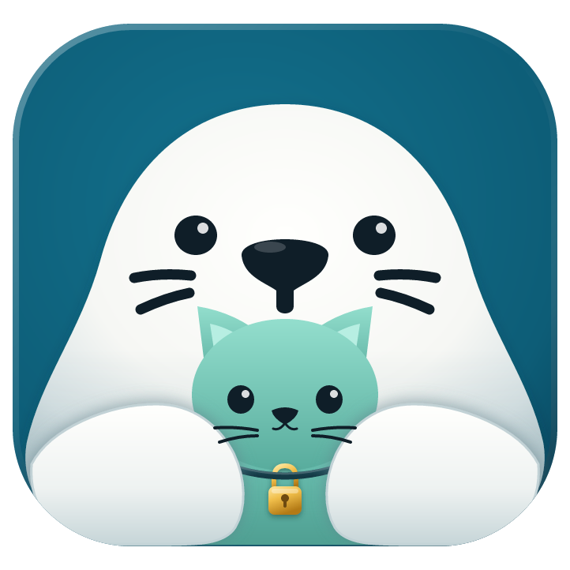

<p align="center">
  
</p>

# SealDesk

English | [简体中文](README.zh-CN.md)

**No relay to run, zero config, sealed end-to-end. Scan to go.**

Open SealDesk on the computer you want to reach and tap **Share this device**.
Scan the QR code from your phone or another computer. That's it: you're in.

No account. No ID server. No relay to host. No port forwarding.

> Tested on Linux x64 / aarch64, Windows, and macOS: connections work as host and as controller. Android is currently tested primarily as a controller.
>
> **macOS**
>
> - The app is not notarized. Before the first launch:
>
>   ```bash
>   xattr -r -d com.apple.quarantine /Applications/SealDesk.app
>   ```
>
> - The app is ad-hoc signed. After each upgrade, Screen Recording, Accessibility, and Input Monitoring may stop working. In **System Settings > Privacy & Security**, remove the old SealDesk entry and grant the permissions again.
> - After granting Screen Recording, quit the app and open it again.
>
> There is no iOS build in this release.

## How it works

- **Scan to go.** The QR code holds everything the controller needs: the
  address, the keys, and a temporary password. Nothing to type, nothing to set up.
- **Sealed end-to-end.** Every session runs inside WireGuard. Keys live only on
  your two devices.
- **Zero relay to run.** Devices punch straight through NAT when they can. When
  they can't, a public DERP node forwards packets it cannot read. You never run
  or configure a server.
- **Works offline too.** On the same LAN, devices find each other automatically,
  even without Internet access. Approve the first request, tick **Trust this
  device**, and it connects straight in next time.

## Quick start

1. Install SealDesk on both devices
   ([Releases](https://github.com/runseal-labs/sealdesk/releases)).
2. Host: **Share this device**.
3. Controller: scan the QR code, or paste the `SEALDESK:` code.

Done sharing? Stop sharing and every session closes. Nothing keeps running in
the background.

### Command line (Linux)

```bash
sealdesk --host                     # start sharing
sealdesk --control -                # read a pairing code from stdin
sealdesk --control-file ./code.txt  # Linux/macOS: 0600 file you own
sealdesk --control code.png         # or with a QR image (no password in the path)
# SEALDESK_CONTROL_CODE is read by --control, then removed from the environment.
# It wins over a password-less inline --control <code>, not over --control - or --control-file.
# --control - reads stdin. --control-file reads the file. Neither argument is the code.
# A code that contains a password is rejected on the command line, even if the variable is set.
# Windows does not support --control-file; use --control - or SEALDESK_CONTROL_CODE.
sealdesk --tc-reset-address         # revoke the current address
```

### Relay map and connection troubleshooting

Desktop **Relay settings** lets you save an HTTPS DERP map URL or restore the
default. Initialization failures show the map or relay/bootstrap stage and a
**Retry** action. Saving while sharing restarts sharing and disconnects sessions.
See [DERP configuration and troubleshooting](docs/DERP.md) for when changes take
effect, embedded relay addresses, TLS validation, and network limitations.

## Troubleshooting

- **No approval prompt on the host**: make sure the host is in the "Share this
  device" state and is not locked or asleep.
- **Scanning times out**: a QR code appearing only means the host is ready, not
  that the path is reachable. Some networks (corporate or campus networks,
  forced proxies, deep traffic inspection) block both direct connections and
  DERP relays, and scanning will always time out there. Try the same LAN, or a
  different network such as a phone hotspot. The sharing page shows relay
  connectivity status, so check there first.
- **Black screen or no control on macOS**: permissions most likely broke after
  an upgrade. Remove the old SealDesk entries and grant them again, as
  described in the macOS notes above.

## Keep your code private

A pairing code is a key to your computer. Don't post it, screenshot it, or
paste it into an issue. To revoke one, refresh the password or reset the
address. Quitting the app alone doesn't revoke it.

## Talking to RustDesk

SealDesk can reach original RustDesk hosts over direct IP (TCP 21118), and
vice versa. That path uses RustDesk's legacy protocol and is **not encrypted**.
It is off unless explicitly enabled, and turning it on shows a warning.
SealDesk also warns before connecting. RustDesk IDs, hbbs/hbbr, and accounts
are not supported.

## Build

See [BUILDING.md](BUILDING.md). Contributions are welcome: read
[CONTRIBUTING](docs/CONTRIBUTING.md) and [SECURITY](docs/SECURITY.md) first.

## License

AGPL-3.0, same as upstream. SealDesk is an independent fork of
[RustDesk](https://github.com/rustdesk/rustdesk) and is not endorsed by RustDesk
or Tailscale. See [NOTICE](NOTICE), [third-party notices](THIRD_PARTY_NOTICES.md),
and [FORK.md](FORK.md).
