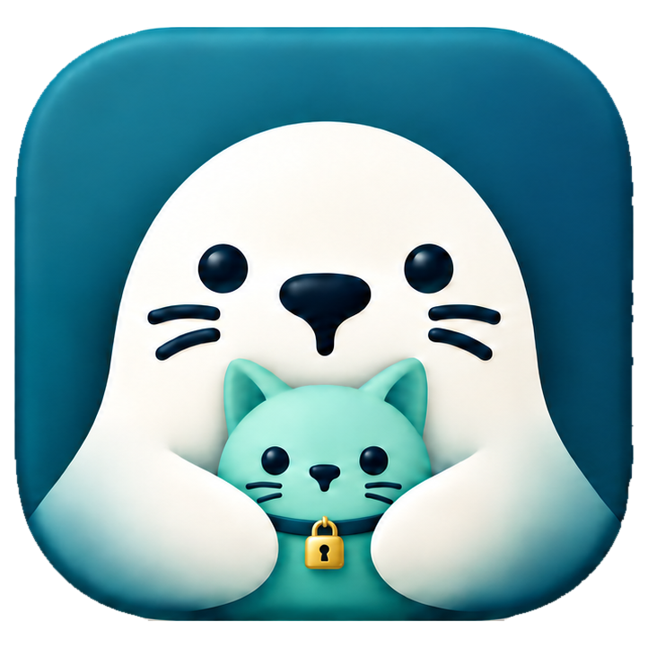

<p align="center">
  
</p>

# SealDesk

English | [简体中文](README.zh-CN.md)

**No relay to run, zero config, sealed end-to-end. Scan to go.**

Open SealDesk on the computer you want to reach and tap **Share this device**.
Scan the QR code from your phone or another computer. That's it: you're in.

No account. No ID server. No relay to host. No port forwarding.

> Tested on Linux x64, Android arm64, Windows and macOS. The macOS app is not notarized, so Gatekeeper may block the first launch. There is no iOS build in this release.

## How it works

- **Scan to go.** The QR code holds everything the controller needs: the
  address, the keys, and a temporary password. Nothing to type, nothing to set up.
- **Sealed end-to-end.** Every session runs inside WireGuard. Keys live only on
  your two devices.
- **Zero relay to run.** Devices punch straight through NAT when they can. When
  they can't, a public DERP node forwards packets it cannot read. You never run
  or configure a server.
- **Works offline too.** On the same LAN, devices find each other automatically,
  even without Internet access. Approve the first request, tick **Trust this
  device**, and it connects straight in next time.

## Quick start

1. Install SealDesk on both devices
   ([Releases](https://github.com/runseal-labs/sealdesk/releases)).
2. Host: **Share this device**.
3. Controller: scan the QR code, or paste the `SEALDESK:` code.

Done sharing? Stop sharing and every session closes. Nothing keeps running in
the background.

### Command line (Linux)

```bash
sealdesk --host                     # start sharing
sealdesk --control 'SEALDESK:...'   # connect with a pairing code
sealdesk --control code.png         # or with a QR image
sealdesk --tc-reset-address         # revoke the current address
```

## Keep your code private

A pairing code is a key to your computer. Don't post it, screenshot it, or
paste it into an issue. To revoke one, refresh the password or reset the
address. Quitting the app alone doesn't revoke it.

## Talking to RustDesk

SealDesk can reach original RustDesk hosts over direct IP (TCP 21118), and
vice versa. That path uses RustDesk's legacy protocol and is **not encrypted**.
SealDesk warns you before connecting. RustDesk IDs, hbbs/hbbr, and accounts
are not supported.

## Build

See [BUILDING.md](BUILDING.md). Contributions are welcome: read
[CONTRIBUTING](docs/CONTRIBUTING.md) and [SECURITY](docs/SECURITY.md) first.

## License

AGPL-3.0, same as upstream. SealDesk is an independent fork of
[RustDesk](https://github.com/rustdesk/rustdesk) and is not endorsed by RustDesk
or Tailscale. See [NOTICE](NOTICE), [third-party notices](THIRD_PARTY_NOTICES.md),
and [FORK.md](FORK.md).
